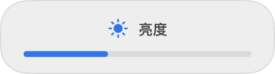

# BDMenu · macOS 多显示器与亮度管理

**用罗技 F4 / F5 调节当前窗口所在屏幕的亮度，让外接显示器工作流更顺手。**

BDMenu 是面向 Apple Silicon Mac 的免费开源菜单栏显示器管理器，使用 SwiftUI + AppKit 构建。它集中管理内建屏与外置屏亮度、显示器启停、分辨率、输入源、镜像、主屏及多屏扩展应用栏，并提供外接屏接入／断开的自动工作流。

**English:** BDMenu is an open-source macOS menu bar display manager for Apple Silicon. Control the focused monitor's brightness with customizable Logitech F4/F5 shortcuts, DDC/CI hardware control or gamma dimming. Includes built-in display automation, display identification, resolution switching and an independent Dock companion with fixed-screen and pointer-follow modes, including vertically stacked displays.

## 亮点与典型场景

| 场景 | BDMenu 的处理方式 |
| --- | --- |
| 窗口在外接屏，鼠标留在 MacBook 上 | F4 / F5 跟随焦点窗口；也可改为跟随鼠标 |
| 夜间需要更细的亮度调整 | 按住 Shift 精细调节；长按可连续调整，底部居中 HUD 不显示百分比 |
| 显示器支持 DDC/CI | 调节硬件背光；检测不可用时提供 gamma 软件调光，并明确显示状态 |
| 外接屏办公，希望关闭内建屏 | 自动工作流管理内建屏、主屏、亮度和按连接组合记忆的布局 |
| 内建屏关闭，不方便触摸 Touch ID | 自动选择受支持系统授权窗口的密码入口并聚焦输入框；内建屏可用且指纹可用时优先 Touch ID |
| 外置屏在上、MacBook 在下，底边呼出会跑到下屏 | 直接把 BDMenu 扩展应用栏固定在上方外置屏内部，或让它跟随鼠标所在屏幕 |
| 分不清屏幕名称 | 在所有在线屏幕上显示编号与名称，再选择管理目标 |

密码入口辅助不读取或输入密码，也不提交授权；无法全局强制所有系统／第三方验证窗口。扩展应用栏是独立的应用启动／切换栏，不搬移原生 Dock，也不改变屏幕排列或鼠标位置。详见下方说明与 [Dock 使用说明](docs/DOCK.md)。

界面采用较大的文字、开关、胶囊按钮和自定义圆角窗体，支持浅色、深色及跟随系统。应用不接管音量或扬声器。



## 快速开始

1. 按下方步骤构建并安装，首次使用允许“辅助功能”权限。
2. 在“快捷键”中确认 F4 / F5，或录制键盘实际发送的按键。
3. 选中目标屏幕上的窗口，使用亮度键；按住 Shift 可精细调整。
4. 在“显示器”中识别屏幕、切换显示模式；在独立的“Dock”页（⌘5）启用扩展应用栏，选择固定屏幕或跟随鼠标。支持单屏、左右与上下排列。

**检索关键词 / Search terms:** macOS display manager · external monitor brightness · focused display · DDC/CI · software dimming · Logitech F4 F5 · multi-monitor Dock companion · stacked displays · app launcher · Touch ID password fallback · Apple Silicon · SwiftUI · 外接显示器亮度 · 罗技键盘 · 多屏管理。

## 功能

- **快捷面板**：左击菜单栏图标快速调节亮度、启停屏幕和全部点亮，在线主屏优先显示；右击打开控制中心、快捷键或退出。
- **多屏扩展应用栏**：固定到指定在线屏幕，或随鼠标跨屏切换；支持上大下小布局。同步系统 Dock 固定的应用及正在运行的应用，点击打开／切换，支持自动隐藏、横向滚动和栏内快捷菜单。不需要先在目标屏幕呼出原生 Dock。
- **控制中心**：显示器、快捷键、自动化、应用与权限、Dock 五个页面，支持 ⌘1–⌘5 导航。关闭窗口后继续在菜单栏运行，重新打开应用可找回窗口。
- **开关任意显示器**:通过 SkyLight 关闭/重新启用显示器；保留至少一块在线实体屏，实际支持取决于 macOS
- **亮度**:
  - 内建屏:DisplayServices 原生亮度
  - 外置屏:DDC/CI 硬件亮度(通过 m1ddc);DDC 检测不可用时使用 gamma 软件调光（显示状态，正常退出恢复原色彩曲线）
- **可自定义亮度快捷键**：默认 F4 降低、F5 提高，调节当前活动窗口所在屏幕；跨屏窗口取占用面积最大的一块屏幕，无法读取窗口时回退到鼠标。也可选择始终跟随鼠标。
- **按键录制**：菜单栏 → 按键设置，分别录制降低／提高亮度的 F 键、媒体键或组合键，绑定自动保存。Esc、关闭设置或切换应用取消录制。普通字符键需搭配 ⌘、⌃ 或 ⌥。
- **精细与连续调节**：按住快捷键连续调节，额外按 ⇧ 精细步进（兼容原来的 ⇧⌥）。可同时接管原生亮度媒体键及 F14/F15；内建屏与外接屏均显示 HUD。需要辅助功能权限。
- **罗技 F4/F5**：默认绑定标准 F4/F5。若键盘发送媒体事件，在按键设置中录制实际按键；若按键由键盘固件处理、无法录制，请在 Logi Options+ 中设为标准 F 键，或尝试 Fn＋F4/F5。
- **外置屏控制**:输入源切换(DP/HDMI/USB-C)、分辨率/刷新率/HiDPI 切换(displayplacer)
- **自动工作流**(核心):开启后
  - 接入外置屏 → 自动关闭内建屏,外置屏成为主屏(Dock/菜单栏随之迁移)
  - 断开外置屏 → 自动恢复内建屏与之前的亮度
  - 布局自动记忆、重连自动还原,无需手动保存
  - 含恢复保护：拔出最后一块外置屏时尝试恢复已识别的内建屏，过滤已标记的虚拟屏/AirPlay；不猜测显示器 ID
- **镜像模式**、**设为主屏**、**登录时启动**(SMAppService)
- **全部点亮**：恢复可识别实体屏及亮度，同时暂停自动工作流

## 系统要求

- macOS 14+（Sonoma）、Apple Silicon；构建需要 Xcode Command Line Tools
- 外置屏 DDC 支持取决于 Mac、显示器、接口、线材及内置 m1ddc 版本；USB-C/DisplayPort 是常见路径，不能笼统认为所有 HDMI 都不支持

## 安装与构建

```bash
./build.sh       # 使用固定签名身份，生成 ~/Library/Application Support/BDMenu/Build/BDMenu.app
./install.sh     # 安装/更新到 /Applications/BDMenu.app，并启动
```

首次构建会选择唯一的 Apple Development（或 Developer ID Application）身份，并记在仅本地的 `.signing-identity` 中。没有证书或存在多个候选时会停止并给出指引，不会静默退回临时签名。可显式选择：

```bash
security find-identity -v -p codesigning
CODE_SIGN_IDENTITY='你的证书 SHA-1' ./build.sh
```

如果没有可用身份，可在 Xcode → Settings → Accounts → Manage Certificates 中配置 Apple Development 证书。测试/CI 可以使用 `./build.sh --adhoc`，但此构建不保证更新后保留辅助功能授权。

**从旧版本升级**：安装完成后，在系统设置 → 隐私与安全性 → 辅助功能中移除旧 BDMenu，重新添加并允许 `/Applications/BDMenu.app`。面板会自动更新授权状态，必要时退出并重新启动。签名身份兼容且 Bundle ID 不变时通常可延续授权，但不能保证永久有效。

登录时启动：在面板中打开开关；需要审批时会进入系统登录项设置。

## 2.3 支持上下排列的扩展应用栏

- 改用独立的 **BDMenu 扩展应用栏（Dock companion）**：直接在目标屏幕内部显示，解决上方外置屏底边连着下方 MacBook、无法正常召唤系统 Dock 的场景。
- 支持固定屏幕和实际的鼠标跨屏跟随，拖动／操作栏期间暂停跟随；不移动鼠标，不改主屏或屏幕排列。
- 读取系统 Dock 的固定应用，并合并正在运行的普通应用；点击打开／切换，显示运行和当前应用指示，右键可在访达中显示。
- 支持自动隐藏、横向滚动；栏内设置按钮可打开设置，右键可快速切换跟随／固定目标或关闭扩展栏。
- 单屏自动使用唯一在线屏幕；多屏固定目标失联时暂停，不猜测替代目标，目标重连后恢复。使用公开 AppKit / NSWorkspace 能力，扩展栏本身不需要辅助功能授权。
- 移除 2.2 / 2.2.1 的原生 Dock 鼠标底边拦截。之前的方式只能防止部分误触，不能把原生 Dock 迁回指定屏幕，也不适合共享底边的上下布局。
- 这不是系统 Dock 的完整复制：不含废纸篓、文件夹堆栈、窗口预览和完整拖放管理；不隐藏或修改系统 Dock。说明见 [docs/DOCK.md](docs/DOCK.md)。

以下 2.2 / 2.2.1 Dock 内容为历史记录；当前版本已采用上面的扩展应用栏。

## 2.2.1 Dock 独立设置与单屏偏好

- Dock 设置独立为控制中心第五个页面（⌘5），快捷面板和菜单栏右键菜单均有直接入口。
- 单屏也可选择显示方式、选中唯一在线屏幕并查看呼出引导；只关闭多屏保护，不再禁用整组设置。离线目标不会被自动替换。
- 两个明确选项：“跟随鼠标 · 底边呼出”和“固定指定屏幕”。指定目标以屏幕按钮列表直接展示，显示在线／停用／主屏状态。选择目标本身不会自动移动 Dock。
- 运行状态解释单屏、镜像、侧边 Dock、未启用独立空间、离线目标与被覆盖底边等情况，并提供系统 Dock 设置入口。
- 无指针跳动的底边呼出沿用 macOS 行为；仅跨屏不会立即迁移 Dock，定位引导也不是一键搬移。

## 2.2 授权表单修复与多屏 Dock

- 修复“隐私与安全”授权表单未切换：除认证服务外，只检查真实系统设置应用的授权表单，不扫描它的普通设置页面。点击方法入口后，必须确认密码输入页出现才报告成功，并聚焦唯一的安全输入框；不会读写密码或确认授权。
- 自动化页可测试原生验证窗口，查看检测详情并取消测试。测试不会修改系统设置。
- 亮度 HUD 显示图标、名称与进度条；Shift＋亮度快捷键使用 1/4 步进，兼容原有 Shift＋Option；录制过的 Shift 组合保留原意。
- 移除音量界面、DDC 音量探测和写入。应用内图标、胶囊和菜单按钮取消蓝色焦点边框，键盘导航使用柔和填充提示。
- Dock 提供“跟随鼠标（底边呼出）”和“固定屏幕”两种方式。固定模式保护指定屏幕的底部 Dock，不移动指针，不改变主屏与屏幕排列；仅在两块以上非镜像屏幕同时启用时运行，需要辅助功能权限。失联屏幕不会误绑定到另一块屏幕。
- 固定保护保留边角、拖动与垂直跨屏通道；系统仍可能从这些通道或唤醒等场景重新分配 Dock，可在指定屏幕露出的底边再次呼出。目标底边被其他屏幕完全覆盖时提示调整布局。支持当前 Dock 位置检测与屏幕引导。
- 新增“识别屏幕”：在所有在线屏幕上短暂展示编号和名称，方便选择与定位。

Dock 说明见 [docs/DOCK.md](docs/DOCK.md)。

## 2.1 跟随屏幕验证与自定义窗体

- 内建屏在线且 Touch ID 可用时优先指纹；手动停用内建屏、合盖、外接屏工作流停用内建屏，或指纹不可用时优先密码。内建屏恢复后自动恢复指纹偏好。没有内建屏也可使用密码偏好。
- 每次操作前重新确认实际屏幕和指纹可用状态；不启用用户关闭的指纹，不读取、输入或提交密码。只选择 Apple 系统授权窗口明确提供的“使用密码”或“使用 Touch ID”按钮；没有入口时由系统决定，不能全局强制认证方式。
- 控制中心使用无原生标题栏的圆角透明窗体，关闭、最小化、拖动和右下角缩放入口融入界面，保留 ⌘W 和 ⌘1–⌘4。
- 亮度提示统一文字基线、数字宽度和进度条对齐，放在被调节屏幕的下方正中并避开程序坞；多屏负坐标和侧边程序坞不影响水平居中。
- 应用与权限页面增加“预览亮度提示”，仅展示效果，不调整硬件亮度。

## 2.0 全新控制中心

- 从长菜单拆分为轻量快捷面板与独立控制中心，屏幕列表、快捷键录制、自动化、权限恢复各自分组。
- 统一蓝色强调、系统材质、较大字号、胶囊按钮和原生大开关；支持浅色、深色及跟随系统，仅作用于本应用。
- 在线主屏优先展示，多屏时滚动列表，快捷面板底部操作保持可见。
- 可调整大小的原生窗口、右键菜单、重新打开应用找回控制中心，补齐键盘导航与录制取消。
- 更新亮度 HUD，清理 hosting 图层，保留 native 标题栏和清晰的形状匹配焦点。
- 保留 1.x 的按键绑定、显示器控制、软件调光、工作流和密码入口辅助设置。

设计说明见 [docs/UI_DESIGN.md](docs/UI_DESIGN.md)。

## 1.4 内建屏关闭时优先密码验证

- 默认开启「内建屏关闭时优先密码验证」。确认内建屏已关闭且有外接屏在线后，尝试自动选择 Apple 系统验证窗口中的「使用密码」，内建屏恢复时立即停止。
- 只选择已识别 Apple 系统认证服务中的明确密码入口，复用辅助功能权限；不读取、存储、输入或提交密码，不更改 Touch ID、钥匙串、PAM 或系统认证策略。
- 这是界面辅助，不是全局密码认证策略。只处理开放对应辅助功能按钮的系统弹窗；锁屏登录、FileVault、第三方应用、自定义按钮及受保护窗口不保证适用。
- 菜单栏可查看等待、缺少权限、切换成功或切换失败状态；缺少权限时可从此处打开设置。系统不开放接口时仍可手动选择密码。

## 1.3.1 界面放大

- 主面板加宽至 500 点；正文 15 点、说明文字 13 点。
- 统一胶囊按钮，最小高度 40 点；开关视觉放大 20%，设置行最小高度 56 点。
- 镜像及登录启动分别使用完整一行，避免控件拥挤。
- 按键设置加宽至 600 点，使用可滚动的材质卡片与更大的按键标识。

## 1.3 自定义亮度快捷键

- 默认 F4/F5 跟随焦点窗口，保留按鼠标选择屏幕的模式。
- 独立按键设置窗口，支持录制、冲突检查、取消和恢复默认。
- 按键监听只消费已绑定的事件及其释放；其他组合键正常传递。
- 复用 1.2 的每屏状态、后台 DDC 队列、写入合并、软件调光曲线及退出恢复。
- 增加快捷键解析、长按、释放、录制隔离、持久化及焦点屏幕几何选择测试。

## 1.2 修复与优化

- 权限检查、显示器回调、亮度键监听跟随应用生命周期，面板关闭时仍有效；授权中、监听失败、正常启用分别显示。
- 支持系统亮度媒体键和亮度虚拟键码，处理按键释放和事件监听被系统暂停的情况；内建屏保留系统原生处理。
- 外部命令在后台串行执行，具有超时、退出码和错误处理；大量 stdout/stderr 不会把进程卡死。
- 每块显示器独立管理亮度、音量、输入源与模式；连续调节合并为最新值，按设备最大值转换百分比。
- 修复分辨率编号全部被解析为 0 的问题，保留旋转、负坐标和关闭状态；切换主屏保持相对布局。
- 按连接的显示器 UUID 集合保存/恢复布局，拒绝向不同显示器组合套用旧配置。
- 软件调光基于原有色彩曲线，正常退出还原；一次 DDC 写入失败不会立即叠加软件调光。
- 构建完成并验证签名后才替换旧产物；安装在固定路径，检测签名身份变化。
- 暂存及输出应用包存放在本机的 Application Support 目录，避免桌面同步服务在签名时反复添加 Finder 信息；可用 `BDMENU_OUTPUT_DIR` 自定义路径。
- 附带 CLI 修复坐标分隔符丢失、主屏位置/旋转丢失，移除配置恢复中的 `eval`，支持包含空格的工具路径。

验证方式、一次性授权迁移和实机验收项目见 [docs/VALIDATION.md](docs/VALIDATION.md)。

## 工作原理

| 能力 | 实现 |
| --- | --- |
| 显示器开关 | SkyLight 私有 API `CGSGetDisplayList` + `CGSConfigureDisplayEnabled` |
| 内建屏亮度 | `DisplayServicesGet/SetBrightness` |
| 外置屏亮度/输入源 | 内置 m1ddc(DDC/CI over IOAVService) |
| 分辨率/排列/镜像/主屏 | 内置 displayplacer |
| 显示器信息 | `CoreDisplay_DisplayCreateInfoDictionary`(名称/UUID/虚拟屏识别) |
| 热插拔检测 | `CGDisplayRegisterReconfigurationCallback` |
| 焦点屏幕亮度快捷键 | 辅助功能窗口几何 + CGEvent 按键监听；按显示器 UUID 独立控制 |
| 系统验证入口辅助 | Apple 系统认证服务／系统设置授权表单的明确方法按钮；确认页面转换后聚焦安全输入框 |
| 多屏扩展应用栏 | 透明 NSPanel + SwiftUI；NSScreen 定位，NSWorkspace 启动／激活；独立的 UUID 固定与鼠标跟随策略 |

## 借鉴的开源项目

- [Crisp](https://github.com/didriksg/Crisp) — BetterDisplay 开源替代,UI 精简思路、软件调光降级
- [Lunar](https://github.com/alin23/Lunar) — DDC 与黑屏(blackout)方案
- [MonitorControl](https://github.com/MonitorControl/MonitorControl) — 菜单栏 DDC 控制
- [displaydeck](https://github.com/pyxis3-ai/displaydeck) — 自动关闭内建屏 + 幻影屏故障保护
- [OpenDisplay](https://github.com/aquitaine/OpenDisplay) — 受保护布局(热插拔后自动还原)
- [displayplacer](https://github.com/jakehilborn/displayplacer) · [m1ddc](https://github.com/waydabber/m1ddc) — 内置工具(MIT)

## 项目结构

```
Package.swift          SwiftPM 工程
Sources/BDMenu/        AppKit 状态栏／Popover／窗口 + SwiftUI 控制中心、权限与显示控制
Sources/DisplayCore/   可测试的布局解析与子进程执行
Tests/                回归测试
bin/                   内置的 m1ddc / displayplacer 二进制
Info.plist             LSUIElement 菜单栏应用
make_icon.swift        图标渲染脚本
make_icon.sh           图标 → icns
build.sh               固定签名构建 .app
install.sh             安装与更新
cli/                   命令行工具 bds(可选,终端里同样能力)
```

## License

[MIT](LICENSE)
