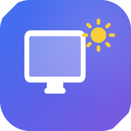
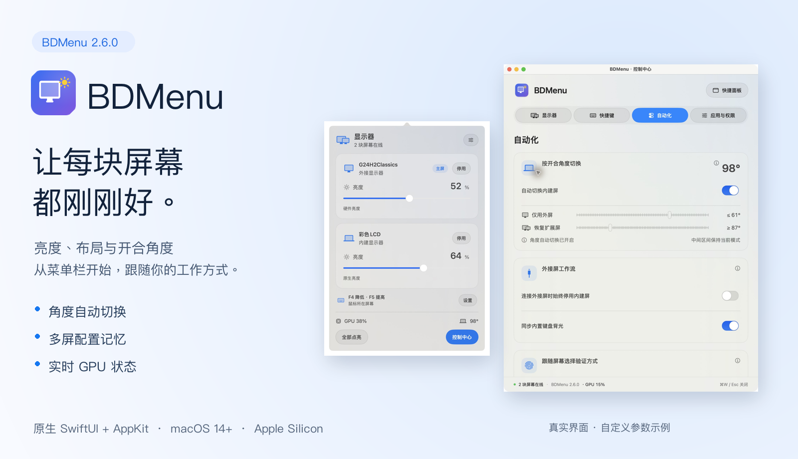
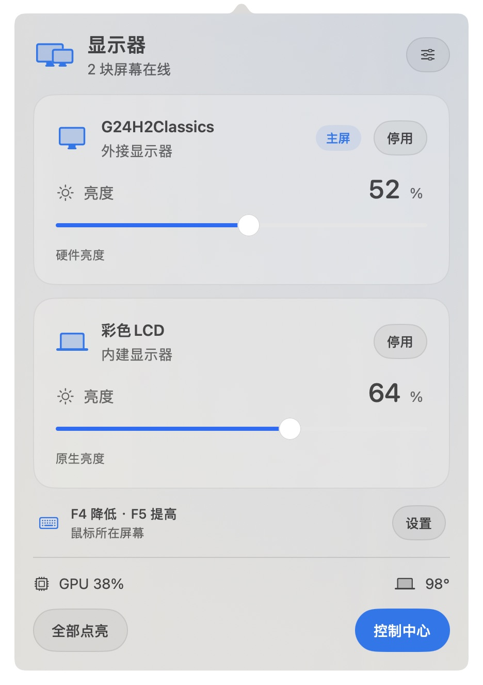
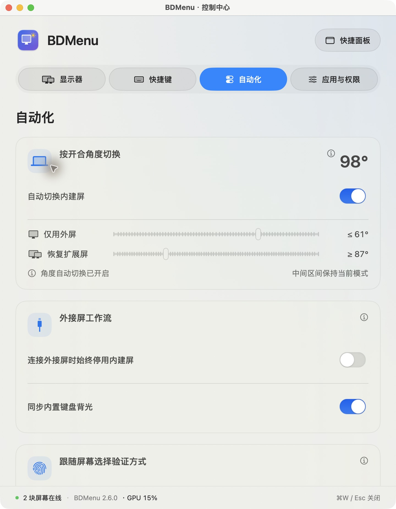
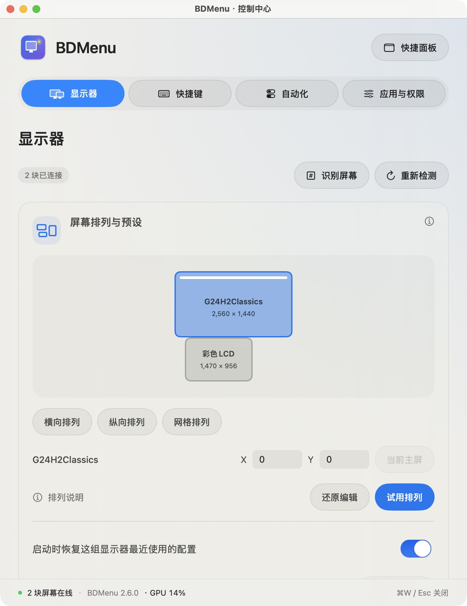
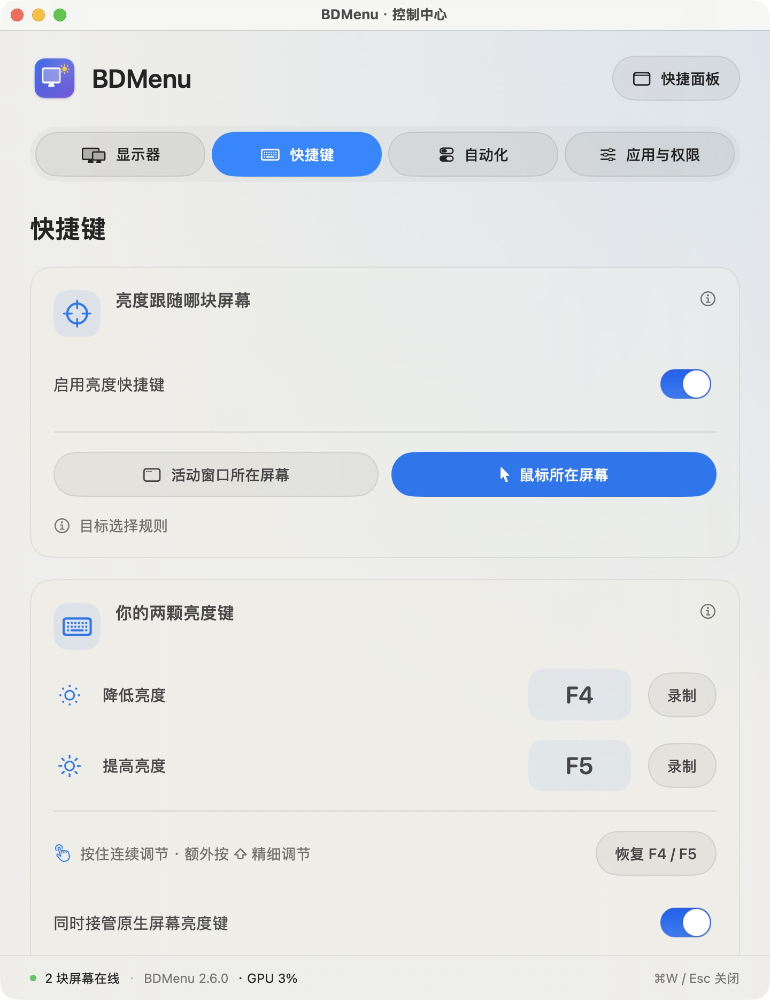
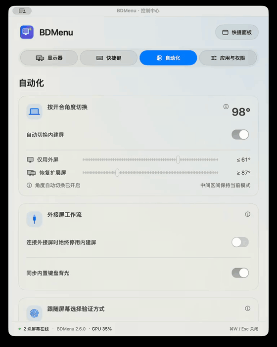

<div align="center">



# BDMenu

**让每块屏幕，都刚刚好。**

原生 macOS 菜单栏显示器工具：亮度、多屏配置、开合角度与实时 GPU 状态。


[](https://github.com/sanbu3/BDMenu/actions/workflows/ci.yml)

[快速开始](#快速开始) · [操作指南](docs/GUIDE.md) · [下一阶段路线图](docs/ROADMAP.md) · [版本记录](docs/CHANGELOG.md)

</div>



## 一个菜单栏入口，照顾整个桌面

| 你的场景 | BDMenu 的做法 |
| --- | --- |
| MacBook 小角度倒扣，只想用外屏 | 根据开合角度停用内屏；展开后重新启用，阈值可调 |
| 外接高刷屏，想比较清晰度和流畅度 | 分开选择 HiDPI 尺寸与刷新率，同时查看 GPU 占用 |
| 经常切换桌面与双屏布局 | 拖动排列、指定主屏，保存预设，并按显示器组合记忆最近配置 |
| 两块屏幕亮度不一致 | 每屏独立调节；F4 / F5 跟随活动窗口或鼠标所在屏幕 |
| 改了显示模式后看不清 | 先试用 15 秒，未保留自动尝试恢复；另有“全部点亮”恢复入口 |

## 看一眼实际界面

<table>
<tr>
<td width="50%" align="center"><b>菜单栏快捷面板</b><p>每屏亮度、启停、GPU 与开合角度</p></td>
<td width="50%" align="center"><b>开合角度自动化</b><p>两个阈值，把倒扣与展开分开处理</p></td>
</tr>
<tr>
<td width="50%" align="center"><b>多屏排列与预设</b><p>拖动屏幕、设置主屏、保存配置</p></td>
<td width="50%" align="center"><b>你的两颗亮度键</b><p>目标屏幕、按键录制与精细步进</p></td>
</tr>
</table>

### 窗口操作实录



[查看 9 秒 MP4 录屏](docs/media/settings-demo.mp4) · [深色自动化界面](docs/images/automation-dark.png) · [外观与权限](docs/images/appearance-dark.png)

截图与录屏来自 2.6.0 实机运行，仅采集 BDMenu 窗口。画面中的显示器名称、角度阈值、亮度、GPU 数值及开关为采集时的自定义状态，不是出厂默认值或性能基准；录屏展示设置入口，未演示自动降载或跨屏窗口适配。

## 快速开始

需要 Apple Silicon Mac、macOS 14+，以及 Xcode Command Line Tools / Swift 工具链。

```sh
git clone https://github.com/sanbu3/BDMenu.git
cd BDMenu
./build.sh
./install.sh
```

`build.sh` 默认使用本机可用的固定 Apple Development 或 Developer ID 签名。没有签名证书时，可先运行 `./build.sh --adhoc` 做本地测试，再执行 `./install.sh`；临时签名更新后可能需要重新授权辅助功能。

安装位置为 `/Applications/BDMenu.app`。左击菜单栏显示器图标打开快捷面板，右击可进入控制中心、快捷键设置或退出。构建输出、签名身份和许可证说明见[构建与权限指南](docs/GUIDE.md#构建签名与权限)。

## 三步设置你的工作方式

### 1. 决定亮度跟随哪块屏幕

进入 **控制中心 → 快捷键**，选择“活动窗口所在屏幕”或“鼠标所在屏幕”。默认 **F4 降低 / F5 提高**；按住连续调节，额外按 **⇧** 使用精细步进，也可以重新录制按键。

内建屏使用原生亮度；外屏优先 DDC/CI，不支持时提供软件调光。辅助功能权限用于亮度键监听与系统验证入口辅助；不授权仍可使用面板滑块。

### 2. 保存常用的显示配置

进入 **显示器**，拖动排列画布，或使用横向、纵向、网格排列；选择主屏，再点“试用排列”。确认后可输入名称并保存当前配置。分辨率、刷新率与 HiDPI 模式也先试用 15 秒。

预设包含排列、主屏、屏幕启停、显示模式及色彩描述文件；只向匹配的显示器组合应用。“启动时恢复最近配置”会按连接组合分别记忆已确认状态。

### 3. 让开合角度决定是否使用内屏

进入 **自动化**，打开“自动切换内建屏”，分别设置两个阈值。

| 默认条件 | 动作 |
| --- | --- |
| ≤65°，并且外屏已启用 | 停用内屏，仅用外屏 |
| ≥80°，并且外屏已启用 | 重新启用内屏 |
| 65°–80° 之间 | 保持当前模式 |

角度连续稳定约 0.8 秒后才触发，切换至少间隔 3 秒。该选项与“连接外接屏时始终停用内建屏”互斥。“全部点亮”会恢复屏幕与亮度并关闭两种自动化。仅在可读到有效角度的设备上执行；当前 M2 Air 已读取到真实角度，其他机型与 macOS 版本仍需验证。

完整说明见[操作指南](docs/GUIDE.md)，包括手动覆盖、拔线恢复、输入源与常见问题。

## 清晰度与负载，一起看

- **分辨率 / 刷新率 / HiDPI 分开选择**：只展示系统提供的可用模式。
- **60 / 120 Hz 对照**：保持逻辑尺寸及 HiDPI 不变，便于实际比较。
- **显示渲染尺寸**：帮助理解同一桌面尺寸背后的像素负载。
- **整机 GPU 占用率**：快捷面板与设置页底部约每 2 秒更新；驱动未提供时显示 `—`。

当前提供监测与手动试用；四种性能预设、持续高负载提醒和自动降载属于[下一阶段计划](docs/ROADMAP.md)。GPU 占用受应用、动画和渲染尺寸等因素共同影响，单个读数不能证明某种模式更省电或更流畅。

## 键盘操作

| 按键 | 操作 |
| --- | --- |
| `⌘,` | 打开控制中心 |
| `⌘1` / `⌘2` / `⌘3` / `⌘4` | 显示器 / 快捷键 / 自动化 / 应用与权限 |
| `⌘W` / `Esc` | 关闭设置窗口，菜单栏继续运行；录制时 Esc 仅取消录制 |
| `F4` / `F5` | 降低 / 提高亮度，可自定义 |
| `⇧` + 亮度键 | 精细调节 |

## 下一阶段：让显示器与窗口共同适应你

**产品方向：macOS 自适应显示器与窗口管理工具。**

三个方向共享同一套设备状态、显示配置事务及窗口管理机制：

| 核心方向 | 下一阶段目标 | 当前基础 |
| --- | --- | --- |
| 智能性能 | 可定制预设、高负载提醒、刷新率优先降载、应用策略 | 已有 GPU 读数、模式枚举与试用恢复 |
| 开合感知 | 开合事件、外屏重连和显示配置联动；角度为可选增强 | 已有实机角度读取和内屏启停联动 |
| 跨屏自适应 | 释放拖动后适配窗口、双向尺寸记忆、热插拔布局恢复 | 尚未实现通用 AX 窗口尺寸管理 |

[阅读统一架构、14 项任务与验收标准 →](docs/ROADMAP.md)

## 兼容性与开发

显示器启停及部分硬件指标依赖底层接口；DDC、输入源控制、模式切换和恢复结果取决于硬件、连接与 macOS。应用保留至少一块可用屏幕，不创建虚拟显示器。当前不包含音量控制或扩展 Dock；这些旧版内容只保留在历史记录中。

```sh
swift test
python3 Tests/test_cli.py
```

2.6.0 本轮本地 Swift 测试为 54 项通过，签名构建已验证。自动化测试不能替代不同显示器、睡眠唤醒、物理合盖及真实窗口操作的兼容性测试。

[操作指南](docs/GUIDE.md) · [验证记录](docs/VALIDATION.md) · [界面设计](docs/UI_DESIGN.md) · [开发路线与来源](docs/REDEVELOPMENT.md) · [历史版本](docs/CHANGELOG.md)

内置 [m1ddc](docs/licenses/m1ddc.txt) 与 [displayplacer](docs/licenses/displayplacer.txt) 保留各自许可证，完整文本随应用打包。角度 HID 协议参考 [LidAngleSensor](https://github.com/samhenrigold/LidAngleSensor)。项目许可证见 [LICENSE](LICENSE)。
