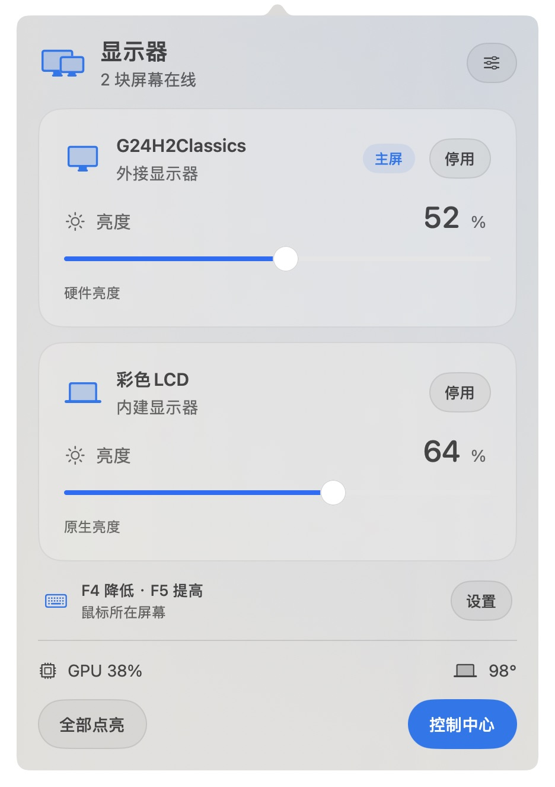
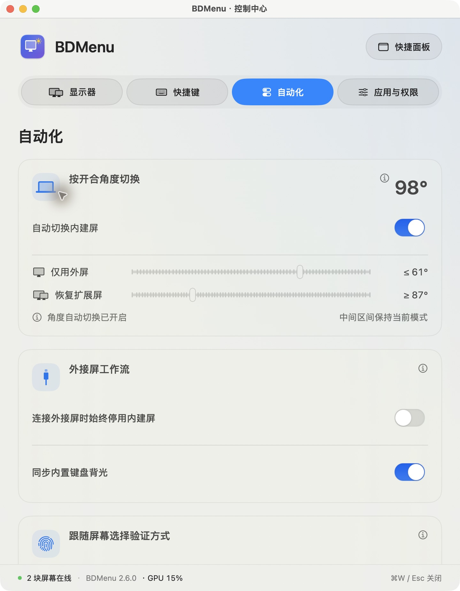
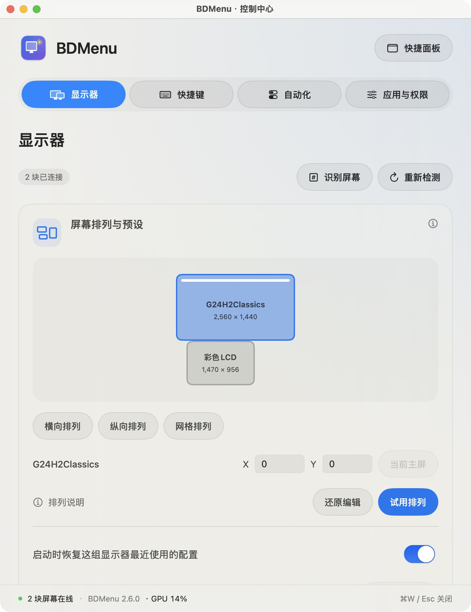
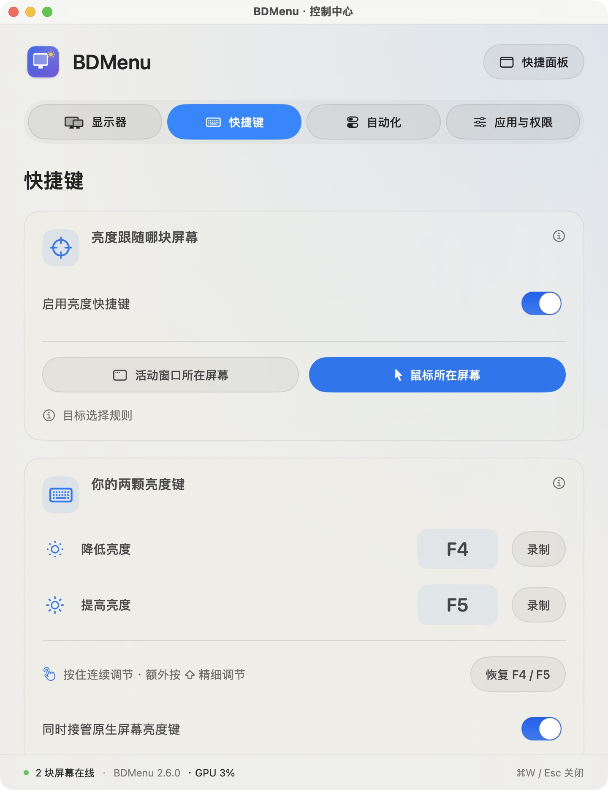
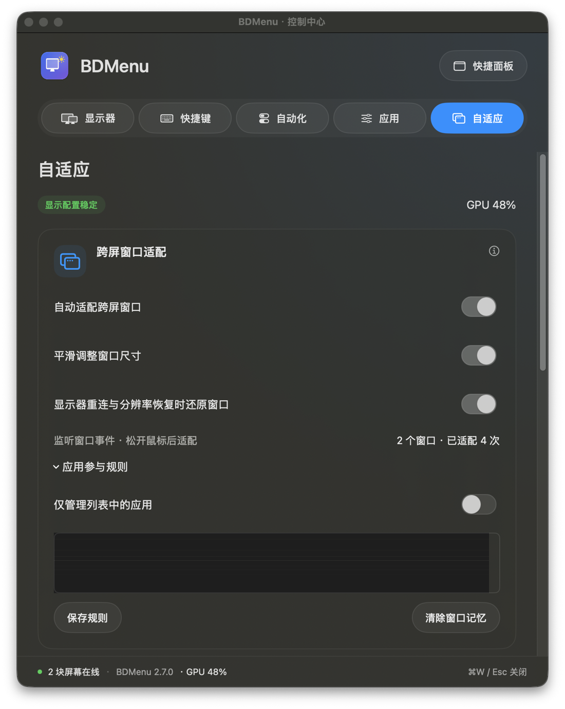

# BDMenu 操作指南

适用版本：2.7.0（下方历史截图另有标注）。返回 [README](../README.md) · [下一阶段计划](ROADMAP.md)

## 从菜单栏开始

左击菜单栏显示器图标打开快捷面板，直接调节每屏亮度、启用或停用屏幕。外接屏实际启用时图标正常显示，仅内屏或外屏停用时图标灰化；灰化后仍可点击。



面板底部可查看 GPU 占用与实际开合角度。“全部点亮”用于恢复屏幕、亮度，并关闭角度自动切换及始终停用内屏工作流。右击菜单栏图标可进入控制中心或退出。

## 用开合角度切换内屏

1. 保持至少一块外屏已启用。
2. 进入“自动化”，开启“自动切换内建屏”。
3. 设定“仅用外屏”和“恢复扩展屏”阈值。较低阈值用于小角度摆放，较高阈值用于展开使用。
4. 在两个阈值之间，保持原有启停状态。

出厂默认阈值是 ≤65° / ≥80°；截图中 61° / 87° 是用户自定义示例。读数是屏幕与键盘的夹角，不能判断整台电脑的空间摆放方向。



角度每约 250 ms 读取，连续稳定约 0.8 秒才触发，两次写入至少间隔 3 秒。不支持角度或没有有效读数时不执行新的角度切换。外屏未启用时不会通过此策略关闭唯一内屏。

“连接外接屏时始终停用内建屏”与角度模式互斥。退出应用、关闭角度自动化时，会尝试恢复该自动化关闭的内屏与先前亮度；拔线恢复沿用外屏断开保护。物理完全合盖仍受 macOS 的睡眠与外接运行条件约束。

手动启用内屏会暂停角度策略的关闭动作，展开到恢复阈值后重新进入自动控制；“全部点亮”则直接关闭自动化。重新打开角度选项可以主动恢复自动控制。

## 排列屏幕，保存预设

1. 进入“显示器”，在画布中拖动屏幕，或点击横向、纵向、网格排列。
2. 点击屏幕后可输入 X/Y 逻辑坐标，或设为主屏。白色顶部条表示主屏；主屏决定菜单栏与 Dock 的默认屏幕。
3. 点击“试用排列”，在 15 秒内选择保留。仅编辑草稿不会立即移动实际屏幕；“还原编辑”丢弃草稿。
4. 需要反复使用时输入名称，点击“保存当前配置”。



预设记录排列、主屏、启停、显示模式及色彩描述文件，只有显示器组合匹配时可应用。启动恢复默认使用同一组合最近已确认的配置；未确认试用不作为已确认配置保存。

## 选择分辨率、HiDPI 与刷新率

显示器卡片提供独立菜单。只显示系统已开放的模式，不新增系统缩放模式。

- **分辨率**：选择桌面的逻辑尺寸；数字相同也要区分普通模式和 HiDPI。
- **刷新率**：只在当前逻辑尺寸和 HiDPI 条件下选择可用刷新率。
- **文字清晰度**：试用可用 HiDPI 或普通模式。同尺寸不可用时明确显示替代尺寸。
- **流畅度对照**：比较当前格式下的 60 / 120 Hz，保持逻辑尺寸与 HiDPI 不变。
- **显示模式**：展开系统提供的完整模式列表。

每次模式调整先试用 15 秒，未保留自动尝试恢复；连接变化时不会将旧配置直接套用到不同显示器组合。恢复失败请使用“全部点亮”或系统显示器设置。

GPU 是驱动报告的整机占用，不是 BDMenu 自身 GPU 占用；约 2 秒更新，缺失时显示 `—`。负载会随前台应用、动画、视频与渲染尺寸变化，比较模式时请使用同一场景。可选自动降载与可定制预设位于“自适应”（⌘5），只自动调整同逻辑尺寸与 HiDPI 的刷新率。

## 设置亮度快捷键



选择目标规则，再根据需要录制按键：

| 目标 | 行为 |
| --- | --- |
| 活动窗口所在屏幕 | 调节活动窗口占用面积最大的一块；无法读取时回退到鼠标屏幕 |
| 鼠标所在屏幕 | 无需点击窗口，鼠标放在哪块屏幕就调节哪块 |

默认 F4 / F5 降低与提高；按住连续调节，额外按 Shift 精细调节。启用“同时接管原生屏幕亮度键”后也处理受支持的系统亮度键。

点击“录制”后按下目标按键；Esc 取消。提高与降低不能使用冲突绑定。普通字符键需搭配 Command、Control 或 Option，也可以直接使用 F 键或受支持媒体键。部分罗技键盘需在 Logi Options+ 中切换标准 F 键或使用 Fn。

## 外观、提示与权限

支持浅色、深色和跟随系统，仅影响 BDMenu。标题或控件旁的信息图标提供悬停说明。⌘W / Esc 关闭设置后，应用继续在菜单栏运行；录制时 Esc 只取消录制。

[深色界面示例](images/automation-dark.png) · [应用与权限界面](images/appearance-dark.png)

辅助功能页分别展示“系统已允许”和“亮度按键正在监听”。权限用于亮度键与系统验证入口辅助，不授权仍可手动调亮度。验证辅助只选择系统明确提供的密码/Touch ID 入口，不读取、填写或提交密码，也不承诺覆盖所有系统授权窗口。

## 自适应窗口与性能

进入控制中心的 **自适应（⌘5）**。窗口适配和自动降载默认关闭，可以分别启用。



### 平滑窗口适配

- 开启“自动适配跨屏窗口”，按需开启“平滑调整窗口尺寸”。
- 窗口移动/缩放事件稳定约 120 ms，且鼠标已释放后才处理；尺寸过渡约 0.18 秒。再次按下鼠标或显示配置发生变化时停止过渡。
- 首先收缩到可移动尺寸，再移到目标位置并扩大，避免 AppKit 按旧位置截断恢复后的高度。
- 系统启用减少动态效果时直接完成；AX 响应慢的应用用一次最终调整替代动画积压。
- 双向尺寸与位置记忆按 AX 窗口身份和显示器标识隔离，只保留当前应用运行会话。全屏、最小化、不可缩放、模态及系统授权窗口跳过。
- 可开启显示器重连/分辨率恢复时还原窗口。临时应急缩小不覆盖原屏记忆；用户手动移动或改尺寸会成为新的偏好。
- “应用参与规则”填写 Bundle ID，每行一个。关闭“仅管理列表中的应用”时作为排除名单，开启时作为允许名单。保存后生效。

### 性能预设与自动降载

每个外屏提供画质优先、均衡、性能优先和低功耗模板，可分别绑定系统实际支持的模式。下拉选择只修改预设；“试用”才切换，保留原有 15 秒确认。不可用组合不会被替换成别的分辨率。

自动降载默认阈值为 GPU ≥80% 持续 20 秒，可调整。自动选择同逻辑尺寸、同 HiDPI 的下一档较低刷新率，最低不低于 60 Hz。负载持续低于阈值 25 个百分点达 60 秒后尝试恢复，动作间至少冷却 90 秒。

可选空闲 3 分钟后降刷新率。全屏、拖动、显示配置未稳定及手动试用期间暂停；用户手动显示操作优先并暂停自动策略 90 秒。自动切换失败会暂停降载并显示恢复提示。

临时模式记录原配置与自己写入的模式。退出或下次启动时仅在显示器组合及当前模式仍匹配时尝试恢复，避免覆盖外部或手动改动。用户主动改显示配置会放弃旧临时配置的恢复权。

### 前台应用策略

添加应用 Bundle ID 和预设，前台稳定 3 秒后尝试应用；自动规则只使用同逻辑尺寸与 HiDPI 的刷新率。离开后尝试恢复原刷新率，可将应用排除出自动性能策略。自动规则与后台降载共用配置通道；不支持的组合会跳过。

### 开合预设与恢复

“自动化 → 开合与重连配置”可选择已保存的仅外屏、展开后预设，须匹配当前显示器组合及目标内屏启停状态。未选择时沿用只切换内屏的行为。可选外屏重连恢复最近配置。

角度二态与系统开合状态独立；角度不可用但系统二态可用时可回退到开/合联动。系统合盖睡眠限制仍由 macOS 决定。“全部点亮”会取消待执行显示命令并关闭相关自动化及窗口管理，保留恢复入口。

## 构建、签名与权限

```sh
./build.sh
./install.sh
```

- 最低 macOS 14，当前打包目标 ARM64，内置 `m1ddc` 与 `displayplacer`。
- 构建默认查找固定 Apple Development 或 Developer ID 身份；可通过 `CODE_SIGN_IDENTITY` 指定。本机选择保存在不入库的 `.signing-identity`。
- 没有证书时运行 `./build.sh --adhoc`，再执行 `./install.sh`。这是本地临时测试方式，不能保证更新后授权身份稳定。
- 构建产物：`~/Library/Application Support/BDMenu/Build/BDMenu.app`；默认安装：`/Applications/BDMenu.app`。
- 构建签名校验通过不等于已公证。下载包的 Gatekeeper 与授权行为应以该包的实际签名、公证结果为准，不要全局关闭系统安全保护。
- 更新身份改变后，若按键监听失效，在系统设置 → 隐私与安全性 → 辅助功能中重新添加当前安装的应用。应用不会修改 TCC 数据库。
- 工具许可证位于应用 `Contents/Resources/Licenses`。

## 常见问题

| 现象 | 处理 |
| --- | --- |
| 外屏亮度没有反应 | 检查显示器 DDC/CI 开关、线缆与转接器；软件调光改变画面明暗，不改变硬件背光 |
| 某个分辨率或刷新率没有出现 | 当前只提供系统可见模式；不以自定义模式绕过硬件或链路限制 |
| 角度显示不可用 | 可能没有可用传感器、接口不同或暂时读取失败；保留手动显示器控制 |
| 模式试用后画面不可见 | 等待 15 秒恢复；必要时使用全部点亮或系统显示器设置 |
| 如何启用窗口适配 | 控制中心 → 自适应（⌘5），开启自动适配；默认关闭 |
| GPU 占用很高 | 先固定应用和画面对照刷新率/HiDPI；不根据单个百分比认定原因 |

## 媒体与验证范围

截图、深色主题截图及窗口录屏均为 2026-11-27 的 2.6.0 实机素材；截图与视频采集时间不同，数值和开关可不同。视频只记录 BDMenu 窗口，不含麦克风或系统音频，发布版仅保留约 9 秒设置入口片段。封面为真实截图排版，未修改截图中的读数。完整说明见 [媒体来源](media/README.md)。

当前测试覆盖策略与配置逻辑；物理开合、不同显示器和 macOS 的兼容性仍需实际验收。参见 [验证记录](VALIDATION.md)。
