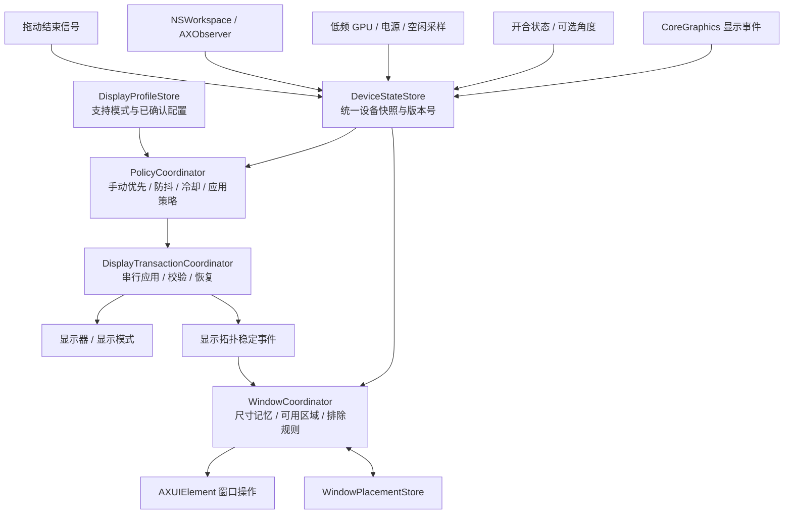

# BDMenu 下一阶段开发基线

更新：2026-11-28 · 已进入 2.7.0 初版实施 · 本文为开发计划，不代表全部功能已经实现。

**产品定位：macOS 自适应显示器与窗口管理工具。**

智能性能、开合感知、跨屏自适应必须共享设备状态、显示配置及窗口管理机制。不能分别建立三个持续轮询、各自修改显示器与窗口的后台模块。

## 2.7.0 实施进展

本轮已实现 `DeviceStateStore`、`WindowCoordinator`、性能控制器与共享配置保护。当前显示写入仍由 `DisplayManager` 的单一入口协调，独立的显示事务服务拆分可继续迭代，不将建议服务名等同于已完成的架构迁移。

| 方向 | 已落地 | 仍需继续验收 / 完善 |
| --- | --- | --- |
| 共享状态 | 拓扑版本、配置中/稳定状态、睡眠、前台应用、GPU、电源、开合二态和可选角度 | 更多硬件、系统版本与指标可用性 |
| 窗口 | 释放后适配、短动画、双向尺寸记忆、分辨率/重连恢复、应用参与规则 | 真实鼠标拖动体验矩阵、Spaces/Stage Manager、复杂窗口约束；跨应用重启持久匹配暂不启用 |
| 性能 | 四种可编辑模板、持续负载提醒、刷新率优先降载、空闲策略、前台应用规则 | 真实负载下的稳定性及 CPU/GPU/能耗对照，未声称已证明省电 |
| 开合 | 二态回退、可选仅外屏/展开预设、可选重连配置恢复 | 完整物理合盖、外屏掉线、睡眠唤醒与多机型矩阵 |
| 恢复 | 模式恢复日志、临时模式所有权、取消排队/执行中的显示写入、操作版本淘汰 | 故障注入与更广的并发事件组合 |

原始需求和 14 项验收清单保留在下文；清单“当前状态”列记录 **2.6.0 起点**，不作为本轮已完成全量验收的声明。自动窗口管理和自动降载默认关闭。

## 1. 当前基础与产品边界

| 模块 | 2.6.0 已有基础 | 下一阶段增量 |
| --- | --- | --- |
| 基础显示管理 | 每屏亮度、分辨率、刷新率、HiDPI、主屏、镜像、输入源、排列及命名配置 | 提供统一配置事务和能力查询，供所有策略复用 |
| 智能性能 | GPU 驱动占用率读取、渲染尺寸展示、60/120 Hz 手动对照、模式试用恢复 | 性能预设、持续高负载提醒、自动降载、空闲与前台应用策略 |
| 开合感知 | HID 角度读取、双阈值内屏启停、背光联动、外屏断开恢复机制 | 独立开合状态事件、无角度设备回退、单/双屏专属配置联动 |
| 智能窗口适配 | 已有焦点窗口所在屏幕解析；尚无通用窗口尺寸与位置管理 | AX 窗口监听、跨屏适配、双向记忆、分辨率与热插拔恢复 |

当前版本不含音量控制。需求草案中的音量列为后续候选，需先核对设备 DDC 支持与产品范围；本轮不恢复此前移除的音量或 Dock 功能。

## 2. 统一技术架构

下面的服务名是**建议设计**；现有 `DisplayManager` 仍是当前实现入口，按阶段拆分并接入，避免一次性重写。

### 单一状态源

- `DeviceStateStore` 保存显示器稳定标识、连接/启用状态、主屏、模式、逻辑/渲染尺寸、可用工作区、睡眠状态、开合状态、可选角度、GPU 样本及时间戳、前台应用、拖动状态和有效权限。
- 每次拓扑更新生成递增版本号。所有异步结果携带版本；拔线、睡眠或新事件后，过期结果不得继续写入硬件或窗口。
- 采样能力与数值分开：不支持、无权限、暂时失联、样本过期与真实 0% 分别处理。角度不可用不等于“合盖”。
- 从当前 `HardwareMonitor`、显示器回调及焦点解析逐步接入，所有界面读取同一快照。

### 唯一显示配置写入通道

- 手动模式试用、角度策略、热插拔恢复、性能策略共用串行事务；同一时间最多一个显示配置事务。
- 事务顺序：校验能力与拓扑版本 → 保存显示和窗口基线 → 应用 → 等待稳定 → 回读验证 → 再适配窗口 → 提交已确认配置。
- 手动试用保留现有 15 秒确认与恢复日志。失败时恢复显示基线，再对实际可用拓扑恢复窗口；恢复失败时保留错误与“全部点亮”入口，不反复强写。
- 自动策略不得复用弹窗式试用而循环打断用户。需要独立的受限应用、验证、回滚和失败后暂停策略。
- “全部点亮”优先级最高：取消待处理自动动作并暂停自动化。之后依次为用户手动试用/覆盖、断屏恢复、开合配置、应用策略、后台性能优化。系统物理合盖/睡眠限制始终是可行性约束。

### 共用窗口管理机制

- 窗口调整由 `WindowCoordinator` 单点执行，其他模块只能提交意图。显示模式正在切换、用户正在拖动、AX 权限失效时不写窗口。
- 将 CoreGraphics/AX 与 NSScreen 的坐标系统一成逻辑点坐标，集中处理坐标原点翻转、负坐标、菜单栏、Dock、缩放及旋转；不要把 Retina 渲染像素当窗口坐标。
- 默认监听窗口移动/缩放与鼠标释放，再判断窗口是否真正跨屏。没有拖动结束信号时，优先采用 AX 事件加稳定等待；不静默扩展系统权限。
- 普通可移动、可缩放窗口先行；全屏、最小化、模态窗口、系统授权界面、不可缩放窗口及用户排除应用默认跳过。
- 内存中的窗口身份采用应用启动会话 + AX 窗口引用/可用标识。跨应用重启的持久恢复只在可靠匹配时执行，不能仅凭重复标题或 PID 猜测窗口；不持久保存完整敏感窗口标题。

## 3. 智能性能管理

四种模式是**可自定义模板**，不是所有显示器都能选择的固定组合，也不承诺某一种组合必然低负载。

| 模板 | 用户需求中的逻辑分辨率示例 | 刷新率示例 | 应用条件 |
| --- | --- | --- | --- |
| 画质优先 | 2560 × 1440 HiDPI | 144 Hz | 仅在系统实际提供时可选；渲染尺寸可能远高于面板原生尺寸 |
| 均衡模式 | 1920 × 1080 HiDPI | 120 Hz | 显示器与连接同时支持该组合 |
| 性能优先 | 面板原生 2560 × 1440，普通模式 | 144 Hz | 原生 2K 面板示例；与同逻辑尺寸 HiDPI 明确区分 |
| 低功耗 | 1920 × 1080 HiDPI | 60 Hz | 名称表达策略目标，实际功耗需测量，不能仅由名称推定 |

每个模板按显示器稳定标识保存。系统未提供目标组合时标为不可用，允许用户指定替代；不得擅自将不同逻辑尺寸的模式视为等价。

### 默认自动策略

1. 默认关闭自动降载，先上线可见监测、手动预设和高负载提醒。
2. 用户开启后，要求 GPU 有效样本连续超过可配置阈值与时长；单次峰值不触发。
3. **优先降低刷新率，保持逻辑分辨率、HiDPI 和窗口布局不变。** 只有用户明确允许的预设才可改变逻辑尺寸。
4. 记录降载前的已确认配置；负载恢复需更低的恢复阈值、更长的稳定期及冷却时间，逐级恢复，不在两个模式间来回跳动。
5. 用户拖动、全屏应用、手动试用、睡眠唤醒、拓扑未稳定时暂停；自动切换失败后暂停该策略并提示原因。
6. 前台应用可覆盖预设，支持白名单/黑名单；应用退出或失焦后经稳定期恢复，不立即连续切换。

优先复用驱动低频读取，不常驻启动 `powermetrics` 或要求管理员权限。复用 GPU 指标给界面和策略，按可见性/策略需要调整采样；角度仅在角度界面或相关策略需要时低频采集，系统睡眠时停止。空闲检测优先基于系统事件时间，持续时间与唤醒次数纳入测量。

## 4. MacBook 开合与显示配置联动

| 事件 | 计划行为 | 保护条件 |
| --- | --- | --- |
| 合盖 / 进入小角度策略 | 加载外接屏专属配置 | 外屏实际可用；不承诺阻止系统睡眠或绕过合盖运行限制 |
| 开盖 / 超过恢复阈值 | 恢复对应双屏显示配置，再恢复窗口 | 内屏实际可用、拓扑稳定且没有手动覆盖 |
| 最后一块外屏断开 | 恢复内屏，将原外屏窗口适配到可用区域 | 保留原屏窗口记忆，不把应急适配结果写成原屏基线 |
| 外屏重新连接 | 恢复历史显示配置及匹配窗口布局 | 同一显示器组合、窗口身份可靠且无用户新拖动 |
| 自定义角度变化 | 发出策略意图，交由共用协调器处理 | 双阈值回差、连续有效样本、防抖与统一冷却 |
| 无角度传感器或接口失效 | 退回独立开/合状态事件和手动配置 | 不根据缺失角度猜测动作，不阻塞显示器基本控制 |

精确角度不是所有设备的必备能力。目前 M2 Air 的标准 HID Feature Report 已读到角度；需要补充不同芯片、机型、macOS、睡眠与传感器失联验证。开合二态与角度是独立能力，先做运行时能力检测，再决定界面和策略是否可用。

## 5. 智能窗口适配

| 功能 | 规则与验收重点 |
| --- | --- |
| 跨屏自动缩放 | 默认鼠标释放后执行；超出目标 `visibleFrame` 才缩小和移回区域，不持续干预拖动 |
| 反向尺寸恢复 | 回到原屏恢复该屏记忆；用户主动调整后的尺寸成为新的该屏记忆 |
| 每窗每屏记忆 | 稳定屏幕标识 + 会话内可靠窗口身份；记忆框与应急裁剪框分开存储 |
| 分辨率变化适配 | 显示事务稳定后执行；模式回滚时同时恢复匹配窗口基线 |
| 热插拔恢复 | 拔线先可见，再记忆来源；重连后仅对可靠匹配窗口恢复，尊重期间发生的用户操作 |
| 应用参与规则 | 全局开关、按应用白名单/黑名单；AX 不支持或拒绝时提示并跳过，不反复重试 |

## 6. 技术选型与复用位置

| 技术 | 用途 | 当前复用入口 / 计划 |
| --- | --- | --- |
| Swift / SwiftUI / AppKit | 菜单栏、设置与恢复入口 | `BDMenuApp`、`AppPresentation`、控制中心 |
| CoreGraphics | 拓扑、显示事件、模式与切换 | `DisplayManager`、`DisplayCore`，逐步归入显示服务 |
| IOKit | 可选角度、GPU、开合及电源能力探测 | 现有 `HardwareMonitor` 迁入设备状态层 |
| AXUIElement / AXObserver | 窗口读写与事件监听 | 复用有效权限检查，新增窗口协调服务 |
| CGEventTap | 可选拖动释放信号 | 优先复用现有事件通道；不为各模块重复安装监听 |
| NSWorkspace | 前台应用、生命周期、睡眠与唤醒 | 合并现有工作区观察器 |
| NSScreen | 可用区域与逻辑坐标 | 公用坐标转换层，覆盖负坐标与缩放 |
| displayplacer | 显示模式与布局兼容方案 | 复用当前受控子进程、超时和配置解析 |
| m1ddc | DDC 亮度与输入源等已支持控制 | 不把显示器不支持的控制项呈现为可用 |

## 7. 14 项开发任务与依赖

状态按 2.6.0 实际代码标注。“已有基础”不等于已完成下一阶段实机兼容性验收。统一状态与配置事务需要先于窗口联动落地，不能机械等到第三阶段才搭建。

| # | 阶段 | 任务 | 当前状态 | 下一步验收 |
| --- | --- | --- | --- | --- |
| 1 | 基础能力 | 读取支持的 HiDPI 与刷新率模式 | 已有 | 不支持的分辨率/刷新率组合不可选 |
| 2 | 基础能力 | 性能预设与快速切换 | 部分：已有通用显示预设 | 四种可编辑模板、能力匹配、明确确认逻辑尺寸变化 |
| 3 | 基础能力 | 低开销 GPU 监测 | 已有：约 2 秒采样 | 无数据、样本过期、睡眠恢复与开销测量 |
| 4 | 基础能力 | 模式失败自动回滚 | 已有试用及恢复日志 | 真机失败、断屏、退出与重启后的恢复矩阵 |
| 5 | 窗口管理 | 跨屏窗口自动适配 | 待开发 | 释放后仅处理合格窗口，拖动不闪烁 |
| 6 | 窗口管理 | 双向尺寸与位置记忆 | 待开发 | A→B→A、同应用多窗口、手动改尺寸 |
| 7 | 窗口管理 | 分辨率变化后的窗口恢复 | 待开发 | HiDPI/刷新率试用与回滚统一恢复 |
| 8 | 窗口管理 | 热插拔窗口布局恢复 | 待开发 | 拔线可见、重连恢复、不覆盖新操作 |
| 9 | 智能联动 | MacBook 开合状态检测 | 部分：已有角度联动 | 独立二态源、无角度硬件回退、物理合盖约束 |
| 10 | 智能联动 | 验证精确角度检测 | 部分：M2 Air 已读数 | 机型/macOS 能力矩阵、失联及唤醒 |
| 11 | 共享基础，先行 | 统一设备状态管理器 | 待开发 | 单一快照、版本淘汰、主线程/actor 边界 |
| 12 | 智能联动 | 智能调度与防抖 | 部分：已有角度局部防抖 | 统一仲裁、冷却、降载恢复、手动优先 |
| 13 | 智能联动 | 应用独立配置策略 | 待开发 | 应用排除、前台覆盖、退出恢复 |
| 14 | 全阶段 | 性能及兼容性测试 | 持续，现有单元测试可复用 | CPU/GPU/唤醒次数、拖动体验、权限及设备矩阵 |

推荐落地顺序：**11 + 显示事务骨架 → 1–4 能力补齐 → 5–8 窗口管理 → 9/10/12/13 联动 → 每阶段执行 14**。

## 8. 验收与轻量约束

- 同一显示拓扑下单一写入者；试用、开合、重连、高负载同时触发也不得交叉写入。
- 以 M2 Air + 2K 高刷外屏为首个测试组合，并覆盖单内屏、单外屏、双屏、镜像、负坐标及不同缩放。
- 分别记录窗口/面板关闭与打开时的 CPU、内存、GPU、定时唤醒与输入延迟；相同场景对照，不用瞬时 GPU 数字声称功耗改善。
- 低频采样、事件合并、按需 AX 监听、睡眠停止。新增监听必须注明归属、取消时机与失效恢复路径，不为每个模块启动重复后台任务。
- 权限拒绝、撤销、传感器缺失、显示模式不可用、AX 写入拒绝都有可见退路，基本显示管理继续可用。
- 不增加虚拟显示器，不持续捕屏或读取窗口内容来实现适配，不频繁切模式，不干扰用户正常拖动。

技术 API 的可用性、私有显示器控制及硬件组合仍需以目标 SDK 和实机结果确认。本文规定架构与验收，不把建议参数写成跨设备性能结论。
